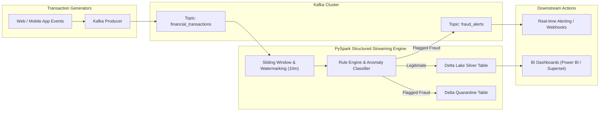

# Real-Time Streaming Analytics & Fraud Detection Platform

[](https://github.com/SoniaBlake-DataEng/real-time-fraud-detection-streaming/actions)
[](https://opensource.org/licenses/MIT)
[](https://www.python.org/downloads/)
[](https://kafka.apache.org/)
[](https://spark.apache.org/)
[](https://delta.io/)

> **High-throughput, low-latency streaming pipeline leveraging Apache Kafka, PySpark Structured Streaming, and Delta Lake to detect financial anomalies, geo-velocity fraud, and transaction spikes with sub-second alerting.**

---

## 🏗️ Architecture & Data Flow



---

## 🛡️ Fraud Detection Rules & Engines

1. **Sliding Window Velocity Spikes**: Flags users attempting >3 transactions within a rolling 60-second window.
2. **Geo-Velocity Impossibility**: Detects card-present transactions occurring hundreds of miles apart within unrealistic time thresholds.
3. **Z-Score Amount Outliers**: Statistically isolates charges deviating >3 standard deviations from historical customer spending.
4. **High-Risk Merchant & Country Filtering**: Real-time cross-referencing against blacklisted Merchant Category Codes (MCC).

---

## 📂 Project Structure

```
real-time-fraud-detection-streaming/
├── .github/workflows/ci.yml       # Automated CI testing
├── docs/
│   └── architecture.md            # Stream processing & watermarking design
├── k8s/
│   └── spark-streaming-job.yaml   # Kubernetes deployment spec
├── sample_data/
│   └── transactions.json          # Seed test transactions
├── src/
│   ├── __init__.py
│   ├── alerts_consumer.py         # Downstream fraud alerting service
│   ├── detector.py                # Core fraud evaluation rules engine
│   ├── producer.py                # Synthetic transaction generator
│   ├── schema.py                  # PySpark & Pydantic schemas
│   └── streaming_app.py           # Spark Structured Streaming application
├── tests/
│   └── test_detector.py           # Unit test suite
├── scripts/
│   ├── setup_github.bat           # 1-click Windows push script
│   └── push_to_github.ps1         # PowerShell deployment script
├── docker-compose.yml             # Kafka, Zookeeper local stack
├── requirements.txt               # Dependencies
└── .gitignore
```

---

## ⚡ Quickstart

```bash
# 1. Clone repo
git clone https://github.com/SoniaBlake-DataEng/real-time-fraud-detection-streaming.git
cd real-time-fraud-detection-streaming

# 2. Setup Virtual Environment
python -m venv venv
.\venv\Scripts\activate  # On Linux: source venv/bin/activate
pip install -r requirements.txt

# 3. Start local Kafka stack
docker-compose up -d

# 4. Run test suite
pytest tests/ -v

# 5. Run synthetic producer & detector
python src/producer.py --rate 10
python src/detector.py --dry-run
```

---

## 📜 License
MIT License.
